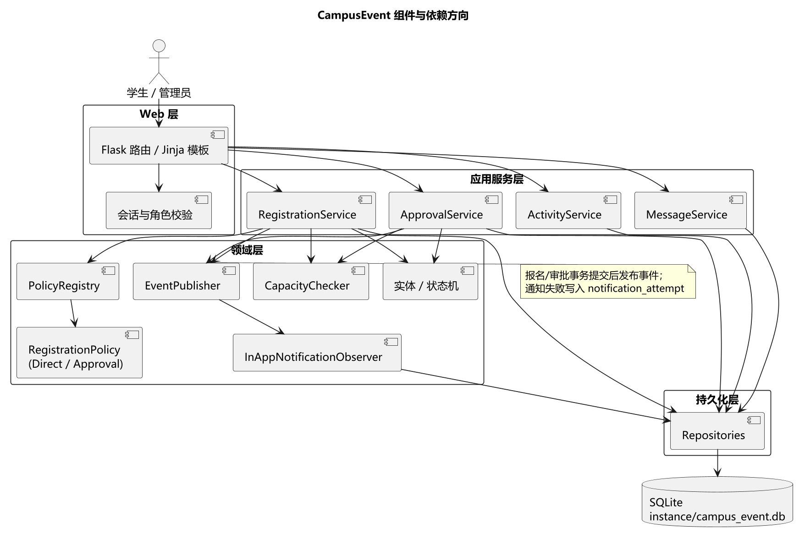
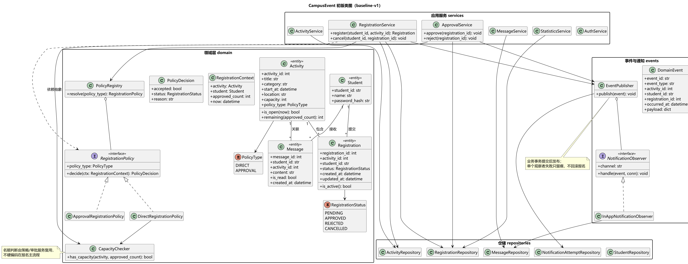
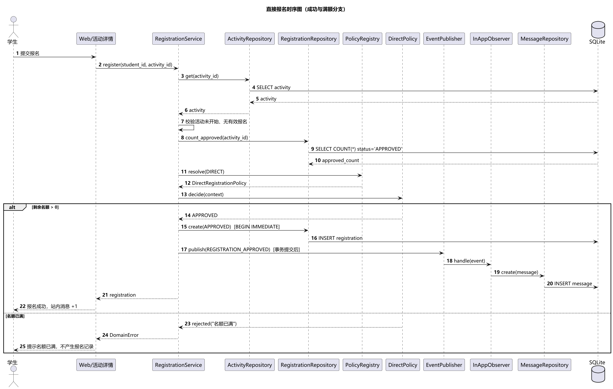
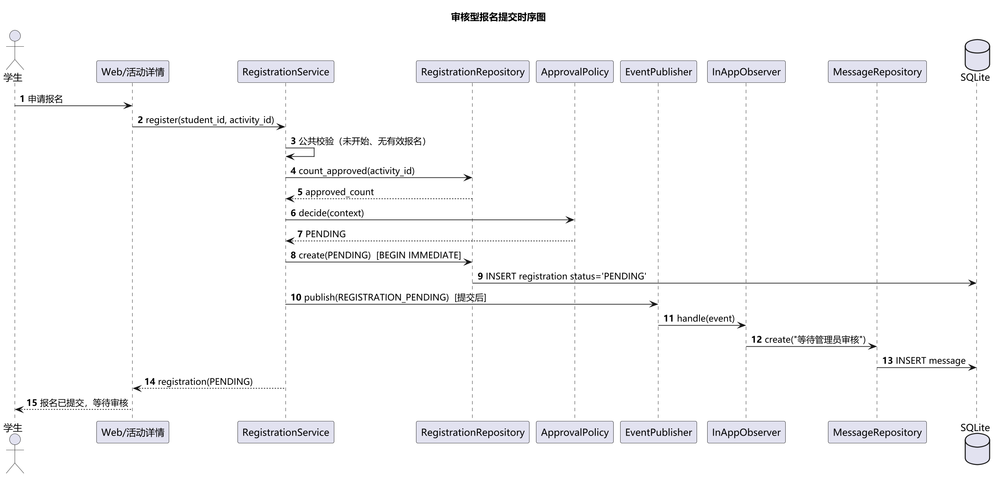
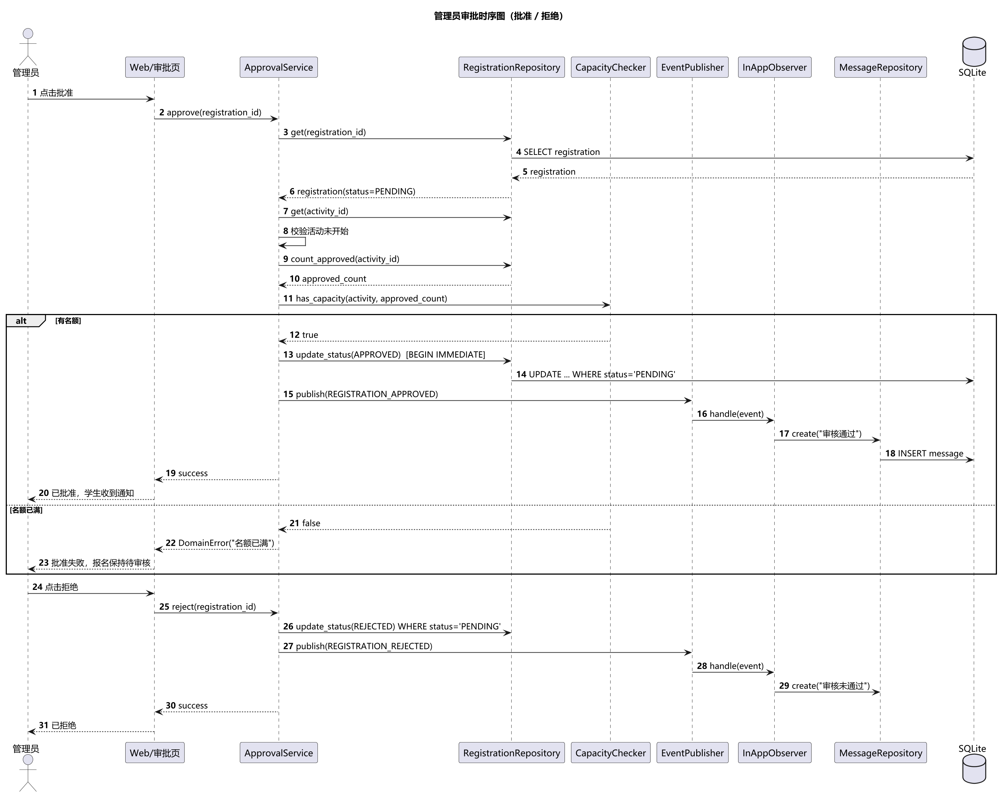
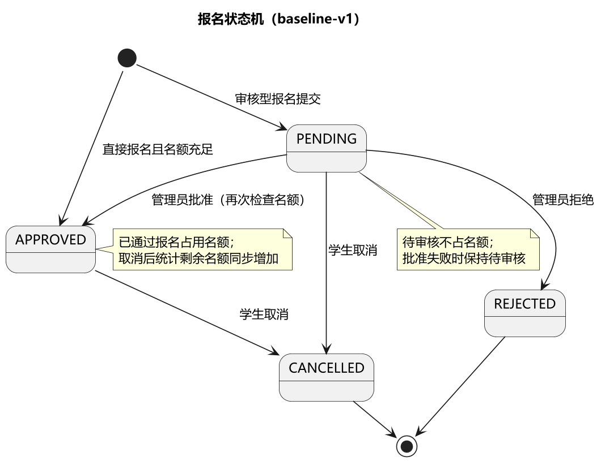
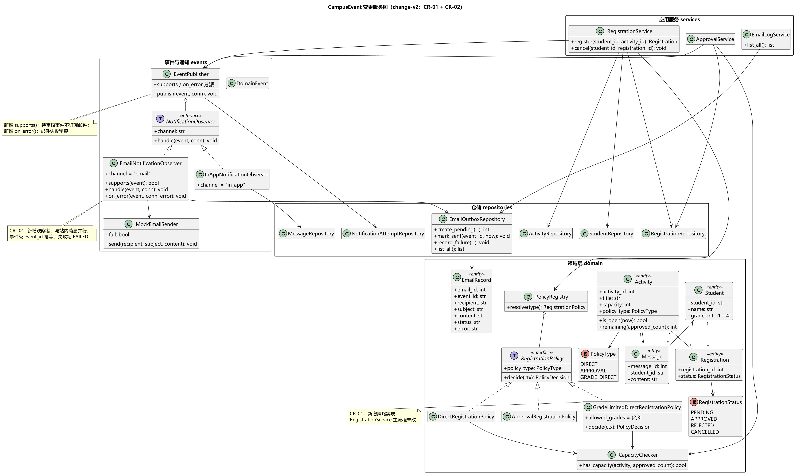
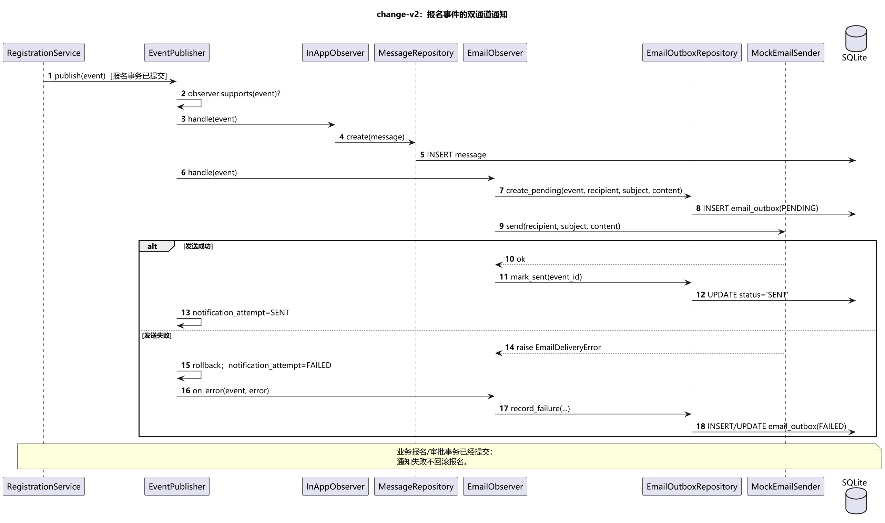

# CampusEvent 设计说明（初始版本 baseline-v1）

> 版本：`baseline-v1` 初始设计 + `change-v2` 变更设计。初始代码见 `app/`（未修改）；变更实现见 `app_v2/`；类图/时序图见 `docs/diagrams/`。
>
> 本文只描述初始版本设计。CR 尚未发布，变更版类图和变更影响分析不在本文范围内。

## 1. 设计目标与原则

1. **职责分离**：Web 只做参数收集与页面渲染；Service 编排用例；Domain 承载规则；Repository 隔离 SQL。
2. **变化点封装**：报名规则用策略模式；通知机制用观察者模式；策略选择用注册表。
3. **可验证**：所有业务规则都能通过服务层单测或 HTTP 集成测试验证；时间可注入。
4. **可迁移**：SQLite + 标准库，无 ORM；`PRAGMA user_version` 预留迁移。
5. **保守范围**：不实现未被要求的候补、邮件等；避免为未来猜测过度设计。

## 2. 总体架构



依赖方向固定为 **Web → Service → Domain/Repository → SQLite**，Domain 不依赖 Flask 或 sqlite3。通知在业务事务提交后由 `EventPublisher` 分发给观察者，避免“通知失败回滚报名”。

| 层 | 主要模块 | 职责 |
|---|---|---|
| Web | `app/web/*`、`templates/` | 登录会话、路由、表单校验错误展示、PRG、角色守卫 |
| Service | `app/services/*` | 用例编排、事务边界、权限与状态检查、调用策略/发布事件 |
| Domain | `app/domain/*` | 实体、枚举、策略、CapacityChecker、事件、通知文案 |
| Repository | `app/repositories.py` | 参数化 SQL、聚合查询、持久化 |
| Infrastructure | `app/db.py`、`schema.sql` | 连接、事务、建库、索引、版本 |

## 3. 领域模型与类图



### 3.1 实体职责

| 类 | 职责 | 关键方法/属性 |
|---|---|---|
| `Student` | 学生身份与登录信息 | `student_id`、`name`、`password_hash` |
| `Activity` | 活动信息与名额/时间判断 | `is_open(now)`、`remaining(approved_count)` |
| `Registration` | 报名记录与状态 | `is_active()`、`status`、`updated_at` |
| `Message` | 站内消息 | `content`、`is_read`、`created_at` |
| `RegistrationStatus` | 状态枚举 | `PENDING/APPROVED/REJECTED/CANCELLED` |
| `PolicyType` | 报名方式枚举 | `DIRECT/APPROVAL` |

### 3.2 关键设计类

| 类/接口 | 职责 |
|---|---|
| `RegistrationPolicy` | 报名规则抽象：输入 `RegistrationContext`，输出 `PolicyDecision` |
| `DirectRegistrationPolicy` | 有名额→已通过；满额→拒绝（不落库） |
| `ApprovalRegistrationPolicy` | 提交→待审核；名额在批准时检查 |
| `PolicyRegistry` | 按 `PolicyType` 返回策略实例；未知类型抛错 |
| `CapacityChecker` | 统一计算“剩余名额是否 > 0”，供策略/审批复用 |
| `RegistrationService` | 公共前置条件 + 选择策略 + 持久化 + 发布事件 |
| `ApprovalService` | 批准/拒绝；批准时复查名额与开始时间 |
| `EventPublisher` | 事务提交后分发事件；逐观察者隔离失败并留痕 |
| `InAppNotificationObserver` | 将事件转为站内消息 |
| `notification_attempt` | 事件+渠道维度的幂等与失败留痕 |

## 4. 报名策略与名额规则

### 4.1 为什么用策略

报名规则存在两个独立变化方向：直接/审核的**时机**不同（提交时 vs 批准时），以及未来可能出现的新规则。若在 `RegistrationService` 写 `if policy_type == ...`，每新增规则都要改核心服务，违反 OCP。策略把“是否受理、落到什么状态”封装起来。

### 4.2 名额检查放在哪

**结论：名额检查属于策略决策的一部分，由 `CapacityChecker` 统一计算，不放在服务层公共前置条件。**

理由：

- 直接报名必须在提交时判断名额，满额则不产生记录。
- 审核型报名提交时不占名额，批准时才判断；若把名额检查前移到服务层，会导致“满额就不能提交审核申请”，与 B.2 规则冲突。
- 把 `CapacityChecker` 作为共享协作者注入策略与审批服务，既统一口径，又保留各策略的时机差异。

`RegistrationService` 的公共前置条件仅包括：活动存在、活动未开始、无有效报名、学生存在。

### 4.3 伪代码

```python
def register(student_id, activity_id):
    activity = activity_repo.get(activity_id)          # NotFound
    student = student_repo.get(student_id)             # NotFound
    ensure(activity.is_open(now), "活动已开始")
    ensure(registration_repo.get_active(activity_id, student_id) is None, "已有有效报名")
    approved = registration_repo.count_approved(activity_id)
    policy = registry.resolve(activity.policy_type)
    decision = policy.decide(RegistrationContext(activity, student, approved, now))
    if not decision.accepted:
        raise DomainError(decision.reason)
    with db.transaction_immediate():
        registration = registration_repo.create(activity_id, student_id, decision.status)
    publish(REGISTRATION_APPROVED or REGISTRATION_PENDING)
    return registration
```

## 5. 通知与事件

### 5.1 事务边界

1. 报名/审批在 `BEGIN IMMEDIATE` 事务中完成并提交。
2. 提交后 `EventPublisher.publish(event)`。
3. 每个观察者：
   - `notification_attempt` 以 `(event_id, channel)` 占位；已存在则跳过（幂等）。
   - 写入站内消息。
   - 成功标记 `SENT`；异常标记 `FAILED` 并保存错误。
4. 通知异常**不回滚**已提交的报名；页面不宣称通知一定成功。
5. 初始版本不自动重试；`notification_attempt` 为后续 CR 的重试/多渠道扩展留痕。

### 5.2 通知文案

| 事件 | 站内消息 |
|---|---|
| 直接报名通过 | 报名成功：您报名的《活动》已通过（时间、地点） |
| 审核型提交 | 报名已提交：您报名的《活动》正在等待管理员审核 |
| 管理员批准 | 审核通过：您报名的《活动》已通过审核 |
| 管理员拒绝 | 审核未通过：您报名的《活动》未通过审核 |

### 5.3 时序图

直接报名（含满额分支）：



审核型报名提交：



管理员批准/拒绝：



## 6. 状态机



| 当前 | 事件 | 条件 | 目标 |
|---|---|---|---|
| 无 | 直接报名 | 名额充足 | 已通过 |
| 无 | 直接报名 | 名额已满 | 不落库 |
| 无 | 审核型提交 | — | 待审核 |
| 待审核 | 管理员批准 | 活动未开始且有名额 | 已通过 |
| 待审核 | 管理员批准 | 满额/已开始 | 保持待审核（报错） |
| 待审核 | 管理员拒绝 | — | 已拒绝 |
| 待审核 | 学生取消 | 本人 | 已取消 |
| 已通过 | 学生取消 | 本人 | 已取消 |
| 已拒绝/已取消 | — | 终态 | 不可再变更；可重新报名 |

## 7. 数据库设计

### 7.1 表与约束

```sql
student(student_id PK, name NOT NULL, password_hash NOT NULL, created_at NOT NULL)
activity(activity_id PK, title NOT NULL, category NOT NULL, start_at NOT NULL,
         location NOT NULL, capacity INTEGER CHECK(capacity > 0),
         policy_type CHECK(policy_type IN ('DIRECT','APPROVAL')),
         created_at NOT NULL, updated_at NOT NULL)
registration(registration_id PK, activity_id FK, student_id FK,
             status CHECK(status IN ('PENDING','APPROVED','REJECTED','CANCELLED')),
             created_at NOT NULL, updated_at NOT NULL)
message(message_id PK, student_id FK, activity_id FK NULL,
        content NOT NULL, is_read INTEGER CHECK(is_read IN (0,1)), created_at NOT NULL)
notification_attempt(event_id, channel, status, error, created_at, updated_at,
                     PRIMARY KEY(event_id, channel))
```

关键索引：

```sql
CREATE UNIQUE INDEX ux_registration_active
  ON registration(activity_id, student_id)
  WHERE status IN ('PENDING','APPROVED');

CREATE INDEX ix_registration_activity_status
  ON registration(activity_id, status);
```

- 部分唯一索引是重复报名的最后防线：即使应用层并发检查失效，数据库也会拒绝。
- 报名/审批使用 `BEGIN IMMEDIATE`，把“读名额 + 写记录”放在同一写事务中。
- 外键开启；`message.activity_id` 使用 `ON DELETE SET NULL` 保留消息正文。
- `PRAGMA user_version = 1`；后续 CR 用迁移脚本升级，不直接改历史表。

### 7.2 数据访问

- 全参数化 SQL；`sqlite3.Row` 映射为 dataclass。
- 连接放在 Flask `g`，请求结束关闭；测试使用临时数据库。
- 时间统一存 ISO 8601（含 `+08:00`），显示时格式化；业务比较在 Python 中完成。

## 8. 接口与页面

| 路由 | 方法 | 角色 | 说明 |
|---|---|---|---|
| `/login` | GET/POST | 公开 | 登录 |
| `/logout` | POST | 已登录 | 登出 |
| `/activities` | GET | 学生 | 列表 + `q` 名称筛选 |
| `/activities/<id>` | GET | 学生/管理员 | 详情、统计、本人报名状态 |
| `/activities/<id>/registrations` | POST | 学生 | 报名 |
| `/registrations/<id>/cancel` | POST | 学生 | 取消本人报名 |
| `/me/registrations` | GET | 学生 | 我的报名 |
| `/me/messages` | GET | 学生 | 消息列表 + 未读数 |
| `/me/messages/<id>/read` | POST | 学生 | 标记已读 |
| `/me/messages/read-all` | POST | 学生 | 全部已读 |
| `/admin` | GET | 管理员 | 活动列表 + 统计 |
| `/admin/activities/new` | GET/POST | 管理员 | 新建活动 |
| `/admin/activities/<id>/edit` | GET/POST | 管理员 | 编辑活动 |
| `/admin/activities/<id>/delete` | GET/POST | 管理员 | 删除确认/执行 |
| `/admin/activities/<id>/registrations` | GET | 管理员 | 报名/审批列表 |
| `/admin/registrations/<id>/approve` | POST | 管理员 | 批准 |
| `/admin/registrations/<id>/reject` | POST | 管理员 | 拒绝 |

- 成功操作使用 303 重定向 + flash；表单校验失败重新渲染并保留输入。
- 未登录访问受保护路由 → 登录页；角色不符 → 403。
- 无 JSON API；页面即对外接口。

## 9. 关键流程

### 9.1 报名

`RegistrationService.register`：活动/学生存在 → 未开始 → 无有效报名 → 取已通过数 → 策略决策 → 事务插入 → 提交 → 发布事件。

### 9.2 批准

`ApprovalService.approve`：取报名 → 必须是待审核 → 活动未开始 → 取已通过数 → `CapacityChecker` → `BEGIN IMMEDIATE` 内 `UPDATE ... WHERE status='PENDING'` → 提交 → 发布事件。若更新行数为 0，说明被并发处理，报冲突。

### 9.3 取消

`RegistrationService.cancel`：取报名 → 归属校验 → 状态为待审核/已通过 → 更新为已取消 → 提交。初始版本不产生取消通知（需求只要求报名/审核结果通知）。

## 10. 异常、校验与安全

| 场景 | 处理 |
|---|---|
| 活动/报名不存在 | `NotFoundError` → 404 |
| 角色不符/非本人 | `PermissionDeniedError` → 403 |
| 重复报名、状态冲突 | `ConflictError` → 提示；数据库唯一索引兜底 |
| 名额已满/活动已开始 | `DomainError` → 表单提示，不落库 |
| 通知观察者异常 | 记录 `notification_attempt=FAILED`，不影响业务事务 |
| 表单非法 | 重新渲染 200，字段级错误 |
| SQL 注入 | 参数化查询 |
| XSS | Jinja 自动转义；消息正文不拼接 HTML |
| 密码 | werkzeug 哈希；会话 Cookie `HttpOnly`、`SameSite=Lax` |

已知限制：无 CSRF token；演示管理员密码固定；SQLite 单写者；通知 best-effort 无自动重试。均写入 README 与测试报告。

## 11. SOLID 与职责边界

| 原则 | 体现 |
|---|---|
| SRP | 策略只决定受理结果；服务只编排；观察者只发通知；仓储只做 SQL |
| OCP | 新增报名规则/通知渠道通过新增实现 + 注册，不改主流程 |
| LSP | 两种策略实现同一 `decide` 契约，可互换 |
| ISP | 策略/观察者接口只暴露必要方法 |
| DIP | Service 依赖策略、观察者、仓储抽象；Domain 不依赖框架 |

## 12. 扩展点与变更准备

- **新增报名规则**：实现 `RegistrationPolicy`，在 `PolicyRegistry` 注册，扩展 `PolicyType` 与数据库约束/迁移；`RegistrationService` 主流程不改。
- **新增通知渠道**：实现 `NotificationObserver`，在组装处注册；`EventPublisher` 不改。
- **数据库迁移**：以 `PRAGMA user_version` 为版本，新增 `migrations/00x_*.sql`，不直接重建基线。
- **变更分析**：见 `docs/04_变更影响分析.md`（CR-01/CR-02 实际分析）。

## 13. change-v2 设计（CR-01 + CR-02）

CR-01、CR-02 已实施；本节只描述变更部分，完整类图见 `docs/diagrams/class-v2.png`。



### 13.1 CR-01：年级限定直接报名

- `Student` 增加 `grade`（1—4）；数据库迁移把旧数据默认设为 1。
- 新增 `GradeLimitedDirectRegistrationPolicy`：先判断 `grade ∈ {2,3}`，再复用 `CapacityChecker` 检查名额；拒绝时返回“该活动仅限大二、大三学生报名”。
- `PolicyRegistry` 注册第三策略；`RegistrationService`、`ApprovalService` 代码未修改。
- 活动表单/列表/详情新增“年级限定报名”标签与提示。

### 13.2 CR-02：Mock 邮件通知

- 新增 `EmailNotificationObserver`，与站内消息观察者并列；`supports()` 只订阅报名通过、审核通过、审核拒绝，待审核提交不发邮件。
- `MockEmailSender` 不接真实 SMTP，可注入失败；`email_outbox` 记录收件人、主题、内容、状态、错误、时间。
- `EventPublisher` 增加 `supports()` 跳过与 `on_error()` 失败详情；`email_outbox.event_id` 唯一，`notification_attempt(event_id, channel)` 继续做渠道幂等。
- 发送失败：事务回滚该观察者写入 → `on_error` 写 FAILED → `notification_attempt=FAILED`；报名/审批事务已提交，不回滚。



### 13.3 迁移与兼容

- `schema.sql` 为 v2；`migrations/002_cr01_cr02.sql` 负责 v1→v2（重建 student/activity、增加 grade/策略 CHECK、创建 email_outbox）。
- 旧库启动自动迁移，`PRAGMA user_version=2`；迁移测试验证数据保留与外键完整。
- 旧演示库升级后执行 `python cli.py set-demo-grades` 同步演示年级。

## 14. 结论

初始版本的 Strategy/Observer/Repository 边界在 change-v2 中保持：新增规则通过新策略，新增通知渠道通过新观察者，核心报名/审批服务未修改；数据库迁移与外键重建是本次变更的主要风险，已用迁移测试覆盖。
